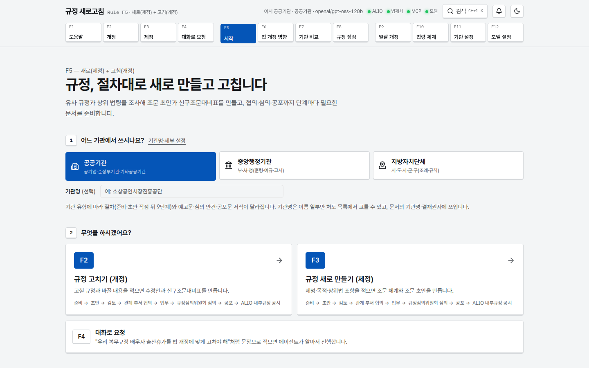
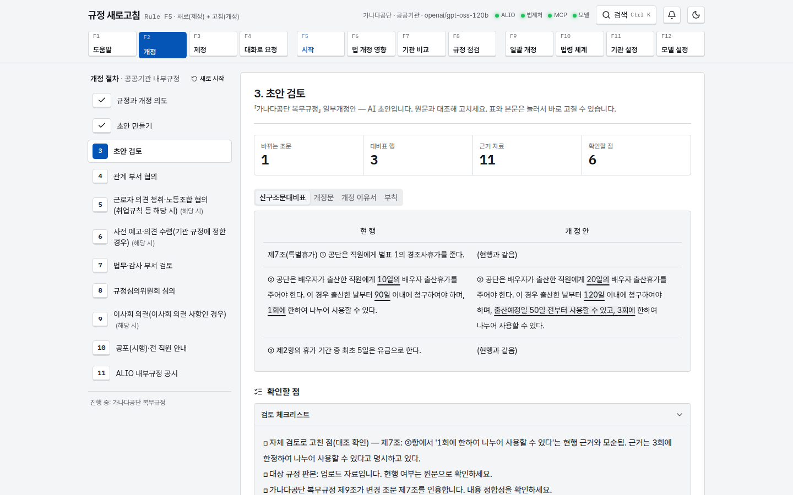
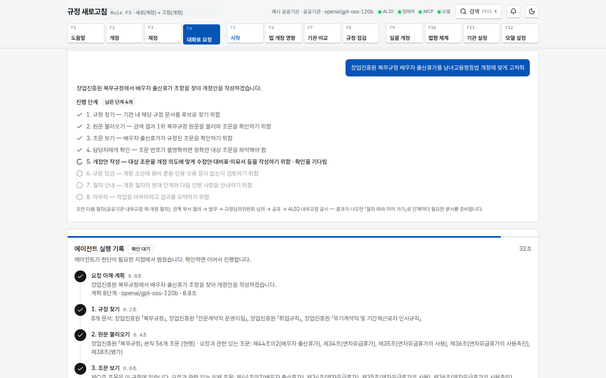
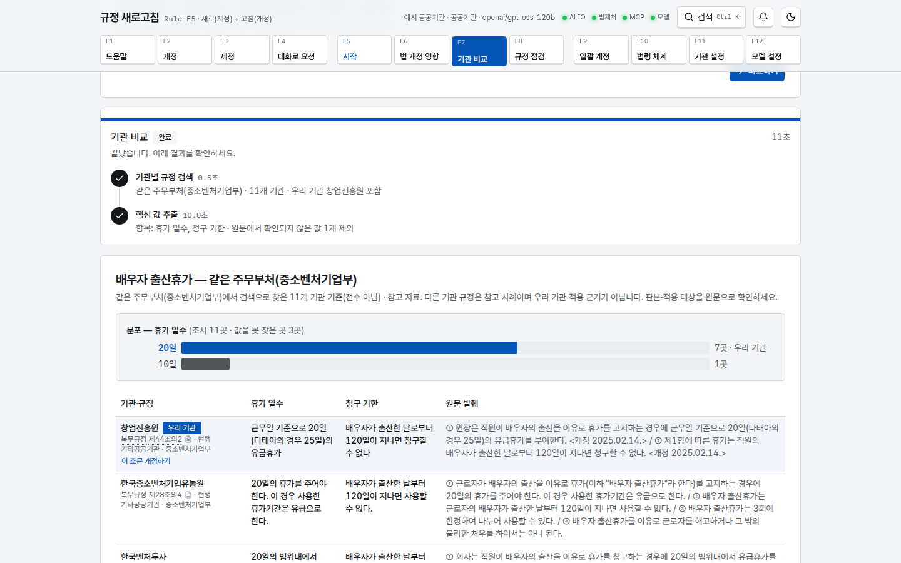

# 규정 새로고침 (Rule F5) — 규정 제·개정 에이전트

> 규정을 **새로** 만들고(제정) **고치는**(개정) 일을 F5 한 번처럼 — 조사부터 대비표·예고문·절차 안내까지.

**🌐 웹 바로 쓰기: https://rulef5.k-union.kr** · [📘 이용 안내](docs/사용안내.md)

공공기관·중앙행정기관·지방자치단체의 규정 담당자가 규정을 새로 만들거나 고칠 때, 에이전트가 유사 규정과 상위 법령을 조사하고 **조문안·신구조문대비표·개정문·이유서·부칙·예고문·인용 정정 목록**을 만들어 협의·심의·공포까지 다음 할 일과 서식을 안내합니다. 모든 결과는 AI 초안이며 담당자가 원문과 대조해 확정합니다.

| 시작 화면 — 기관 유형 선택 | 개정 결과 — 신구조문대비표·개정문 |
|---|---|
|  |  |
| **대화로 요청 — 실행 계획과 진행 기록** | **기관 비교 — 비교표와 값 분포** |
|  |  |

### 목차

1. [접속 주소 (웹)](#접속-주소-웹) · 2. [주요 기능](#주요-기능) · 3. [동작 방식](#동작-방식) · 4. [실행 및 작동 방법](#실행-및-작동-방법) · 5. [실행 파일(배포) 형태](#실행-파일배포-형태) · 6. [모델·외부 서비스](#모델외부-서비스) · 7. [검증](#검증) · 8. [데이터·라이선스·보안](#데이터라이선스보안) · 9. [한계](#한계) · 10. [문서](#문서)

---

## 접속 주소 (웹)

| 구분 | 주소 |
|---|---|
| <b>웹(설치·로그인 없음)</b> | **https://rulef5.k-union.kr** — 한국 IP에서 접속(해외 IP 차단) |

**3단계로 바로 써 보기**

1. 접속 → 시작 화면에서 기관 유형(공공기관·중앙행정기관·지방자치단체)을 고릅니다.
2. **F2 개정** → 「기관 규정(ALIO)」 탭에서 기관명·규정명으로 찾거나(예: 창업진흥원 · 복무규정) 「파일·붙여넣기」로 규정을 올리고 → 개정 의도를 적은 뒤(예시 단추 있음) <b>「초안 만들기」</b>.
3. 확인 단계(대상 조문·근거)에서 고르면 대비표·개정문·체크리스트가 나오고, 왼쪽 절차 단계에서 협의·심의·공포 서식을 받습니다.

서버 모델이 연결되어 있어 **별도 키 없이** 초안 작성까지 동작합니다(하루 호출 한도를 넘으면 F12에서 본인 키 입력).

## 주요 기능

머리글의 기능키 단추(F1~F12)로 이동합니다. 개정(F2)·제정(F3)은 준비 → 초안 → 검토 → 협의·심의·공포 순서의 **절차 마법사**입니다.

| 키 | 메뉴 | 하는 일 |
|---|---|---|
| F2 | **개정** | 대상 조문 탐색 → 근거 조사 → 조문 수정안 → 신구조문대비표·개정문(「제7조제2항 중 "10일"을 "20일"로 한다」 문형)·**개정 후 전문**·개정 이유서·부칙·예고문·인용 정정 목록 → 기관 유형별 절차 단계 |
| F3 | **제정** | 조문 체계(장·조) 설계 → 조문 초안 → 제정안·대비표(<신 설>)·제정 이유서·부칙·예고문·위임 범위 검토표 |
| F4 | **대화로 요청** | 하고 싶은 일을 문장으로 적으면 에이전트가 계획(남은 단계 미리 표시)을 세우고 실행·기록하며, 사람 확인을 받아 문서 세트와 다음 할 일을 내놓음 |
| F6 | 법 개정 영향 | 상위 법령 개정 전·후 조문으로 영향받는 규정 조문을 「반영됨/개정 후보/확인 필요」로 표시, 시행예정 법령 정비 계획서 |
| F7 | 기관 비교 | 같은 주제를 다른 기관은 어떻게 정했는지 비교표·값 분포(같은 주무부처·같은 유형·직접 선택, 지자체는 시·도 단위) |
| F8 | 규정 점검 | 규정 묶음 또는 기관 전체의 인용 오류·용어 혼용·수치 충돌 후보·규정 누락 확인(CSV) |
| F9 | 일괄 개정 | 직제 개편·용어 통일을 여러 규정에 한꺼번에, 바꿀 곳마다 확인, 조사 자동 보정 |
| F10 | 법령 체계 | 법률 → 위임 문구 → 시행령·시행규칙 → 기관 규정 관계를 따라가 개정으로 연결 |
| F1·F5·F11·F12 | 도움말·시작·기관 설정·모델 설정 | 기관 유형·기관명·결재권자·시행 문구, AI 모델·본인 키·법제처 인증키(OC) |

**공통 기능**

- <b>원문 검색(Ctrl+K, AI 없이)</b> 과 **원문 보기**: 화면의 밑줄 친 문서 이름을 누르면 해당 조항·문서 전체가 열립니다.
- **절차별 서식**: 협조 요청 공문, 근로자 의견 청취서, 법무 검토 의뢰서, 심의 안건, 이사회 부의안, 의회 제출 조례안, 공포·발령문 — 기관 유형에 맞춰 채움
- **개정 후 전문**: 규정 전체에 수정안·신설·삭제·조 번호 이동·이번 부칙을 반영한 본문을 바뀐 조문 표시(〈개정〉〈신설〉〈삭제〉)와 함께 제공(개정·일괄 개정·의견 반영 후)
- **의견 반영**: 회신 의견별 처리안(반영·일부 반영·미반영)과 사유, 담당자 선택 후 대비표·개정문·개정 후 전문 수정, 의견 검토서
- **자체 검토**: 법률 주체 용어(사업주·근로자) 대체, 없는 법령명·대통령령 위임 문장 탐지, 항 누락 방지, 다른 규정에 이미 있는 주제 안내
- **기관 유형별 차이**: 공공기관(ALIO 내규), 중앙행정기관(훈령·예규·고시), 지방자치단체(조례·규칙)에 따라 절차·서식·결재권자·시행 문구가 달라짐
- **편의**: 알림음(확인 필요·완료), 새로 고침해도 작업 이어받기, 내보내기(Markdown·HTML 인쇄용·대비표 CSV), hwpx·txt·md 업로드

자세한 설계와 대응표: [docs/features.md](docs/features.md) · 단계별 이용 방법: [docs/사용안내.md](docs/사용안내.md)

## 동작 방식

```
요청(규정·개정 의도) ─▶ 근거 조사 ──────────────▶ 초안(AI) ─▶ 자체 검토 ─▶ 문서 세트 ─▶ 절차 안내
                       ALIO RAG(공시 내규·단체협약)      조문안만     용어·법령명·     대비표·개정문·    협의·심의·공포
                       법제처 Open API(법령·행정규칙·조례)            위임·항 누락     이유서·부칙·서식   서식과 다음 할 일
                              ▲ 담당자 확인(대상 조문·근거·반영 의견) ▲
```

- **근거 우선**: 모든 근거에 출처·판본을 붙이고 원문을 바로 열어 대조합니다.
- **코드와 AI의 분담**: 조 번호 이동·인용 정정·대비표·개정문 문형·절차 서식은 코드가 결정적으로 만들고, AI는 조문 추천과 문안 초안만 맡습니다.
- **사람 확인**: 대상 조문·근거·반영할 의견은 담당자가 고릅니다.

## 실행 및 작동 방법

### (a) 웹으로 바로 사용

[접속 주소](#접속-주소-웹)의 3단계를 따릅니다. 기능별 순서는 [docs/사용안내.md](docs/사용안내.md)에 있습니다.

### (b) 직접 실행

**요구 사항**: Node.js 20 이상(검증 v24.22). 서버는 외부 npm 패키지가 없어 `npm install`이 필요 없고, 화면은 빌드되어 `app/public/`에 들어 있습니다.

```bash
git clone https://gitlab.aigov.go.kr/kised/rulef5.git && cd rulef5
cp .env.example app/.env       # 값 입력(모두 선택 사항, 저장소에 올라가지 않음)
node app/server.js             # http://localhost:8107  (PORT 로 변경, npm start 도 같음)
```

키가 하나도 없어도 실행됩니다. 이때 검색·원문·대비표·인용 탐지·점검·법령 체계·절차 안내는 동작하고, 초안 작성은 F12에서 본인 키를 넣으면 됩니다.

<details>
<summary><b>환경 설정(.env.example)</b></summary>

서버가 `app/.env`, 저장소 루트 `.env`, `.private/app.env` 순으로 읽습니다. 실제 값은 저장소에 올리지 마세요.

| 키 | 설명 |
|---|---|
| `PORT` | 서버 포트(기본 8107) |
| `ALIO_API_BASE` | ALIO RAG REST 주소(기본 공개 주소, 키 불필요) |
| `ALIO_MCP_URL`, `ALIO_MCP_KEY` | (선택) ALIO RAG MCP 주소·키. 인용 관계 조회에 쓰며 없으면 REST만 사용 |
| `LAW_API_OC` | (선택) 법제처 Open API 인증키 — 법령·행정규칙·자치법규 기능([open.law.go.kr](https://open.law.go.kr)에서 발급) |
| `LLM_PRESET` | 서버 기본 모델 공급자(`exaone`·`openrouter`·`nim`). 키가 없으면 키가 있는 공급자로 대체 |
| `EXAONE_API_KEY`, `OPENROUTER_API_KEY`, `NIM_API_KEY` | (선택) 공급자별 서버 키 |
| `SERVER_LLM_DAILY` | 서버 키 하루 호출 한도(기본 300) |
| `LLM_TIMEOUT_MS` | 모델 응답 제한 시간(기본 150000ms) |
| `LLM_PARALLEL` | 제정 시 장별 동시 작성 수(기본 2) |

그 밖의 선택 설정: `REG_VAR_DIR`(런타임 데이터 폴더, 기본 `app/var`), `MAX_JOBS`(동시 작업 수, 기본 4), `RATE_PER_MIN`(IP당 분당 요청, 기본 60), `UPLOAD_DAILY_MB`(업로드 일일 한도, 기본 300), `TRUSTED_PROXY`(신뢰 프록시), `OPENROUTER_MODELS`·`NIM_MODELS`(서버 키 허용 모델).
</details>

<details>
<summary><b>화면 다시 빌드 · 테스트 · 보조 스크립트</b></summary>

```bash
cd web && npm ci && npm run build      # 화면 소스를 고칠 때만 — 결과가 app/public/ 으로
node --test app/test/*.test.mjs        # 단위 테스트 261개(외부 연결·키 없이, 약 90초)
node app/scripts/smoke-sources.mjs     # 실데이터(ALIO·법제처) 연결 확인
```

| 스크립트(`app/scripts/`) | 용도 |
|---|---|
| `agent-eval.mjs [모델] [반복]` | 「대화로 요청」 회귀 평가(몇 번 중 몇 번 통과) |
| `replay-history.mjs run <모델>` | 실제 개정 이력 재현 검증 → `docs/replay/` |
| `verify-models.mjs <모델...>` | 여러 모델로 같은 시나리오 → `docs/model-verification/` |
| `run-flow.mjs <유형> '<입력 JSON>'` | 흐름 하나를 화면 없이 실행 |
| `job-report.mjs [일수]` | 작업 기록 요약(기능별 성공률·실패 원인·느린 단계) |
| `smoke-llm.mjs`·`smoke-sources.mjs` | 모델·데이터 연결 확인 |
| `build-orgs.mjs` | 기관 자동완성 목록 생성 |
</details>

## 실행 파일(배포) 형태

별도 설치 파일 없이 **소스 그대로 `node app/server.js`로 실행하는 Node.js 서버**(외부 패키지 없는 단일 프로세스)와 **빌드된 정적 웹 화면**으로 배포합니다. 공개 서버(https://rulef5.k-union.kr)는 같은 코드를 프록시 뒤에서 상시 실행합니다.

```
app/server.js       HTTP 서버(보안 헤더·요청 한도·정적 파일·API)
app/lib/            데이터·LLM 어댑터, 조문 파서·hwpx, 인용·조 번호, 대비표, 작업 실행기
app/flows/          개정·제정·대화형 에이전트 등 기능 흐름, 자체 검토, 절차 안내
app/procedures/     기관 유형별 절차 템플릿(JSON, 편집 가능)
app/public/         빌드된 화면(서버가 그대로 제공)
app/test/           단위 테스트(node:test)
web/                화면 소스(React + shadcn/ui + Tailwind, Vite)
docs/               이용 안내·기능 설계·아키텍처·검증 기록
```

| 실행 중 생기는 데이터(`app/var/`) | 내용 | 보관 |
|---|---|---|
| `cache` | ALIO·법제처 조회 캐시(인증키는 저장 전 제거) | 24시간 |
| `work` | 올린 파일 원본(읽기 전용·SHA-256)과 작업 결과 | 24시간 뒤 자동 삭제 |
| `logs` | 작업 기록(상태·소요 시간·지표만, 입력 내용·접속 주소 없음) | 30일 |

## 모델·외부 서비스

| 서비스 | 쓰는 곳 | 링크 |
|---|---|---|
| OpenRouter — **GPT-OSS 120B**(공개 서버 기본), Gemma 등 | 초안 작성 | [openrouter.ai](https://openrouter.ai) · [openai/gpt-oss-120b](https://openrouter.ai/openai/gpt-oss-120b) |
| EXAONE(LG AI연구원, `k-exaone_v2.5`) | 초안 작성(F12에서 선택) | `https://api.exaone.ai/v1` · [EXAONE](https://www.lgresearch.ai/exaone) |
| NVIDIA NIM(Nemotron 등) | 초안 작성(F12에서 선택) | [build.nvidia.com](https://build.nvidia.com) |
| 사용자 지정(OpenAI 호환) | 행안부 AI 공통기반·vLLM 등 https 주소를 F12에 입력 | — |
| ALIO RAG(공공기관 공시 내규·법령·단체협약) | 규정 검색·원문·유사 규정·점검 | `https://alio.k-union.kr/api`([상태](https://alio.k-union.kr/api/health)) · [GovScope](https://alio.k-union.kr) · 원자료 [ALIO](https://www.alio.go.kr) |
| 법제처 국가법령정보 Open API | 법령·행정규칙·자치법규 | [open.law.go.kr](https://open.law.go.kr) · [국가법령정보센터](https://www.law.go.kr) |

- **모델 교체**: F12 「모델 설정」에서 공급자·모델·**본인 API 키**와 <b>법제처 인증키(OC)</b>를 넣습니다. 키는 **브라우저 탭(sessionStorage)에만** 보관되고 요청 때만 서버로 전달되며, 서버는 저장·기록하지 않습니다. 서버 기본값은 `.env`의 `LLM_PRESET`으로 바꿉니다.
- 외부 모델 API를 쓰면 입력한 문장과 선택한 공개 조문이 해당 공급자에게 전송됩니다 — **민감정보·개인정보는 입력하지 마세요.**

## 검증

| 항목 | 결과 | 기록 |
|---|---|---|
| 단위 테스트 | 261개 통과(외부 연결·키 없이) | `app/test/` |
| 모델 이식성 | EXAONE·GPT-OSS·Gemma·Nemotron 4종에서 개정·제정·대화형 시나리오 모두 통과 | [docs/model-verification.md](docs/model-verification.md) |
| 실제 개정 이력 재현 | 7건 × 3회: 흐름 완료 21/21, 대상 조문 재현율 0.80 | [docs/replay/README.md](docs/replay/README.md) |
| 레드팀 점검 | 화면·API·기관 유형·실제 문서 등 여러 차례 결함 찾기와 보강 | [docs/features.md](docs/features.md) |

## 데이터·라이선스·보안

- **데이터**: ALIO RAG(공공기관 경영공시·내규·단체협약·법령, 공개 자료), 법제처 Open API(공개 법령). 원문 판본·시행일을 화면에 표시하며, 현행 여부는 원문으로 확인합니다.
- **원본 보호**: 업로드 원본은 읽기 전용(0444)·SHA-256으로 보관하고 결과는 따로 만들며, 24시간 뒤 자동 삭제합니다.
- **보안**: 보안 헤더(CSP 등), IP당 요청 한도, 업로드 한도, 사용자 지정 모델 주소의 내부망 접근 차단, 키·인증키는 로그·캐시에 남기지 않음.
- **라이선스**: 서버는 외부 라이브러리가 없습니다. 화면에 쓴 React·shadcn/ui·Base UI·Tailwind CSS·motion·lucide 등은 MIT 등 허용 라이선스이며 **재배포 제한 구성요소는 없습니다**(`web/package.json`). shadcn 스타일 파일은 MIT 표기와 함께 `web/src/shadcn-tailwind.css`에 포함했습니다.
- **참고한 개발물**: 작성자가 운영하는 ALIO RAG(MCP·REST)와 GovScope(alio.k-union.kr)의 규정 비교·법령정합·최근개정 화면 아이디어를 참고했고, 이 프로젝트는 새로 설계·구현했습니다.

## 한계

- 결과는 초안이며 적법성을 판정하지 않습니다. 유사 기관 규정은 참고 사례이고 우리 기관 적용 근거가 아닙니다.
- 인용·충돌·영향 탐지는 규칙·검색 기반 근사입니다(전수 보장 아님). 0건이 「없음」을 뜻하지 않을 수 있으며 조회 실패는 화면에 표시합니다.
- 응답 시간: 공개 서버 기본(GPT-OSS 120B) 개정 약 15～40초, 대화로 요청 약 30초～1분. EXAONE은 개정 약 1.5～2.5분, 제정 약 4～5분. 서버가 붐비면 더 걸리며, 실제 작업이 15분을 넘으면 중단하고 다시 실행을 안내합니다.
- AI 초안은 실행마다 표현이 조금씩 다를 수 있습니다(반복 평가로 안정성 확인).
- 한글(hwp) 바이너리는 직접 읽지 않습니다. hwpx로 저장해 올려 주세요.

## 문서

| 문서 | 내용 |
|---|---|
| [docs/사용안내.md](docs/사용안내.md) | 기능별 이용 방법(누르는 순서·입력 예시·결과 보는 법·자주 묻는 점) |
| [docs/features.md](docs/features.md) | 기능·설계 상세와 요구 기능 대응표 |
| [docs/architecture.md](docs/architecture.md) | 아키텍처와 정식활용(정보화사업) 이관 안내 |
| [docs/model-verification.md](docs/model-verification.md) | 모델 이식성 실측 |
| [docs/replay/README.md](docs/replay/README.md) | 실제 개정 이력 재현 검증 |
